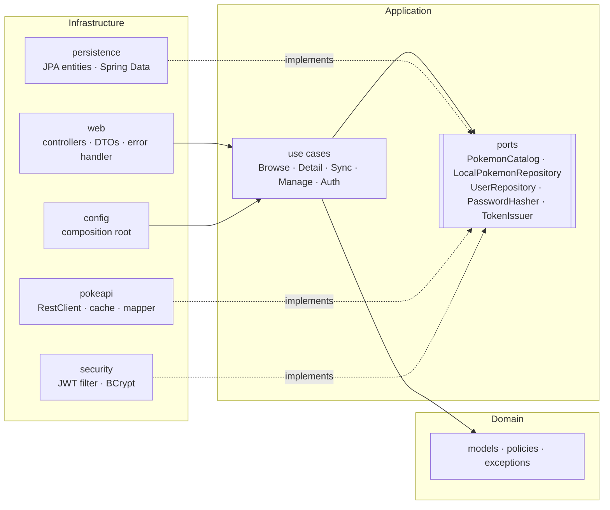

# Pokédex — Ballast Lane Java Technical Exercise

Full-stack app that browses the [PokeAPI](https://pokeapi.co/docs/v2) catalog and keeps a **local, editable replica**
of selected Pokémon enriched with proprietary fields (localized name, region, tags, notes).

| Layer    | Stack |
|----------|-------|
| Backend  | Java 17, Spring Boot 3.3, Spring Security (JWT), Spring Data JPA, Flyway, Caffeine cache, springdoc OpenAPI |
| Database | PostgreSQL 16 (Docker) · H2 file DB in PostgreSQL mode for zero-setup local runs |
| Frontend | React 18 + TypeScript, Vite, React Router, TanStack Query |
| Tests    | JUnit 5, Mockito, AssertJ, MockMvc, MockRestServiceServer, ArchUnit, embedded PostgreSQL, Vitest + Testing Library |

---

## Quick start

### Option A — Docker (PostgreSQL + API + web)

```bash
docker compose up --build
```

| URL | What |
|-----|------|
| http://localhost:3000 | Web app |
| http://localhost:8080/swagger-ui.html | Interactive API docs |
| http://localhost:8080/actuator/health | Health check |

If a port is taken on the host: `BACKEND_PORT=8082 FRONTEND_PORT=3001 docker compose up --build`.

### Option B — Local (no Docker)

Requirements: JDK 17+, Maven 3.6+, Node 20+.

```bash
# 1. API on :8080 (H2 file database at backend/data/, created and seeded on first run)
cd backend
mvn spring-boot:run

# 2. Web on :5173 (proxies /api to :8080)
cd frontend
npm install
npm run dev
```

If port 8080 is taken: `PORT=8082 mvn spring-boot:run` and `VITE_API_PROXY=http://localhost:8082 npm run dev`.

### Demo data

| Username | Password     | Role  | Notes |
|----------|--------------|-------|-------|
| `admin`  | `admin123`   | ADMIN | Can delete local Pokémon |
| `ash`    | `pikachu123` | USER  | Can import, edit and refresh |

Seven Pokémon (Bulbasaur, Charmander, Squirtle, Pikachu, Eevee, Mewtwo, Garchomp) are pre-loaded in the local
database by the Flyway migration `V2__demo_pokemon.sql`, including custom fields. The demo users are created on
startup by `DemoUserSeeder` (disable with `SEED_USERS=false`).

### Running the tests

```bash
cd backend && mvn test        # 116 tests + coverage gate, report in target/site/jacoco/index.html
cd frontend && npm test       # 14 tests
```

---

## User stories → implementation

| Story | Endpoint | Notes |
|-------|----------|-------|
| **US01** Paginated list with sprite, category, weight and abilities | `GET /api/pokemon?page=0&size=20` | PokeAPI list pages only include names. Each entry is enriched **in parallel** with `/pokemon` and `/pokemon-species` (the *category* is the Pokédex genus, e.g. "Seed Pokémon"). All calls are **cached** (Caffeine, 6 h TTL). |
| **US02** Detail with image, stats, description and evolution chain | `GET /api/pokemon/{idOrName}` | Combines `/pokemon`, `/pokemon-species` and `/evolution-chain`. The evolution chain is a **tree**, so branching evolutions (Eevee) work, and each step has a readable trigger ("Level 16", "Use Thunder stone", "High friendship (night)"). |
| **US03** Persist Pokémon locally with proprietary fields | `POST /api/local-pokemon` · `POST /api/local-pokemon/{id}/sync` | Import copies the catalog data into PostgreSQL. Optional custom fields: `localizedName`, `region` (enum), `tags`, `notes`. *Sync* refreshes catalog data and **keeps** the custom fields. |
| **US04** Update local Pokémon with validation | `PUT /api/local-pokemon/{id}` | 404 for a missing record, 400 for malformed JSON, wrong types or rule violations (with per-field errors), 415 for a wrong content type. **Lost updates are prevented**: the PUT requires `If-Match` with the ETag that was read (428 if missing, 412 if someone saved a newer version). |

### Full API

| Method | Path | Auth | Description |
|--------|------|------|-------------|
| POST | `/api/auth/register` | public | Create a user (role USER) and return a JWT |
| POST | `/api/auth/login` | public | Exchange credentials for a JWT |
| GET | `/api/auth/me` | user | Current user |
| GET | `/api/pokemon` | public | US01 — catalog page |
| GET | `/api/pokemon/{idOrName}` | public | US02 — detail |
| GET | `/api/local-pokemon?page&size&search` | user | List the local replica (search by name or localized name) |
| GET | `/api/local-pokemon/{id}` | user | Get one (`ETag` header = current version) |
| POST | `/api/local-pokemon` | user | US03 — import from PokeAPI (201 + `Location`) |
| POST | `/api/local-pokemon/{id}/sync` | user | US03 — refresh catalog data |
| PUT | `/api/local-pokemon/{id}` | user | US04 — update proprietary fields. Requires `If-Match: "<version>"` |
| DELETE | `/api/local-pokemon/{id}` | **admin** | Delete (204) |

Every error uses the same contract:

```json
{
  "timestamp": "2026-10-09T20:18:36Z",
  "status": 400,
  "error": "Bad Request",
  "message": "Invalid Pokemon customization",
  "path": "/api/local-pokemon/1",
  "fieldErrors": { "region": "must be one of [KANTO, JOHTO, ...]" }
}
```

---

## Architecture

The backend follows **Clean Architecture**. Dependencies only point inwards, and the core (domain + application)
is plain Java with **no Spring, JPA, Jackson or JWT imports**. `ArchitectureTest` (ArchUnit) enforces both rules
on every build.



```
backend/src/main/java/com/ballastlane/pokedex
├── domain/                 # Enterprise rules: no framework code
│   ├── model/              # PokemonSummary, PokemonDetail, EvolutionNode, LocalPokemon, User, PageQuery...
│   ├── policy/             # CustomizationPolicy, CredentialsPolicy (business validation)
│   └── exception/          # NotFound, Validation, Conflict, InvalidCredentials, ExternalService
├── application/            # Application rules
│   ├── port/               # Interfaces the core needs (implemented by infrastructure)
│   └── usecase/            # One class per use case, plain constructors
└── infrastructure/         # Frameworks and drivers
    ├── pokeapi/            # PokeAPI adapter (RestClient + Caffeine + parallel enrichment)
    ├── persistence/        # JPA adapters + entities (Flyway owns the schema)
    ├── security/           # Stateless JWT, BCrypt, route rules
    ├── web/                # REST controllers, request/response DTOs, GlobalExceptionHandler
    └── config/             # ApplicationConfig wires use cases (composition root), seeders, OpenAPI
```

### Key design decisions

- **Use cases are not Spring beans by annotation.** They are created in `ApplicationConfig`, so the core can be
  unit tested with plain `new` and mocks, and could be moved to another framework unchanged.
- **Two layers of validation.** Jakarta Bean Validation on DTOs checks the *shape* of a request (size, required).
  Domain policies check the *business rules* (region must exist, tag format, max tags, credentials strength) and
  normalise input (trim, lower-case tags, blank → null). Both return 400 with `fieldErrors`.
- **Ports isolate the outside world.** `PokemonCatalog` hides PokeAPI. The use cases only see domain models and
  `Optional`. A PokeAPI 404 becomes `Optional.empty()`, while timeouts and 5xx responses become
  `ExternalServiceException`, which the API returns as **502**.
- **Caching sits on the HTTP client**, not on the adapter. Each raw resource (`pokemon`, `species`,
  `evolution-chain`, list page) is cached separately and reused across endpoints. For example, warming the list
  also warms the detail page. This also avoids the Spring proxy self-invocation pitfall.
- **Parallel enrichment.** A page of 24 Pokémon needs about 48 upstream calls on a cold cache. They run on a
  bounded executor (`pokeapi.parallelism`, default 8), which is fast without hammering PokeAPI.
- **Input hardening.** `idOrName` is normalised and validated before anything is forwarded upstream, so there is
  no path traversal or junk sent to PokeAPI.
- **Stateless JWT (HS256)**, with the role carried as a claim. Login returns the same 401 for an unknown user and
  for a wrong password, so it does not reveal which usernames exist. Passwords use BCrypt, and the secret must be
  at least 32 bytes or the app refuses to start.
- **Flyway owns the schema** (`ddl-auto: validate`). The same migrations run on H2 (tests and local) and on
  PostgreSQL. `PostgresCompatibilityTest` runs them against a real embedded PostgreSQL binary.
- **No lost updates (optimistic concurrency).** Every local Pokémon has a `version`, exposed as an `ETag` and as a
  JSON field. A PUT must send `If-Match` with the version it read. If two people edit the same Pokémon, the second
  save gets **412** instead of silently overwriting the first one, and the web app reloads the latest data and
  tells the user. The check is a domain rule (`LocalPokemon.ensureVersion`). The persistence adapter also compares
  versions, and JPA `@Version` covers the last moment before the UPDATE. A missing `If-Match` is **428**
  (RFC 6585), so no client can skip the check by accident.

### Frontend

```
frontend/src
├── api/          # fetch wrapper (ApiError, bearer token), typed endpoints, DTO types
├── auth/         # AuthContext (session in localStorage, auto-logout on 401), ProtectedRoute
├── hooks/        # TanStack Query hooks (server state, cache invalidation after mutations)
├── components/   # Layout, PokemonCard, StatBars, EvolutionTree, CustomizationForm, Pagination, Status
└── pages/        # Catalog, Detail, Collection, Edit, Login/Register, 404
```

- **State management.** Server state lives in TanStack Query (caching, `keepPreviousData` for smooth pagination,
  and invalidation after mutations). The only client state is the auth session in context. Pagination and search
  are kept in the URL, so they survive a reload and can be shared.
- **Responsive.** CSS grid and flex with breakpoints at 800 / 600 / 420 px. Light and dark themes follow the OS
  setting.
- **Clean console.** There are no React or Router warnings in the browser console (React Router v7 future flags
  are enabled).
- **Accessibility.** Uses semantic landmarks, `role="alert"` for errors, `aria-invalid` on fields, and
  `role="meter"` for stat bars.

---

## Testing strategy

Written test-first, starting from the use cases and domain policies, then moving to the adapters.

| Level | What | Examples |
|-------|------|----------|
| Domain unit | Policies, value objects, entity behaviour | `CustomizationPolicyTest`, `PageQueryTest`, `LocalPokemonTest` |
| Use case unit | Business flows with mocked ports | `SyncPokemonUseCaseTest` (conflict, not found, validation before any I/O) |
| Adapter | PokeAPI mapping with **real JSON fixtures** and a mocked HTTP server; caching; JWT | `PokeApiCatalogAdapterTest`, `PokeApiClientCachingTest`, `JwtTokenServiceTest` |
| Persistence | Flyway + JPA on H2 **and on real PostgreSQL** | `JpaLocalPokemonRepositoryAdapterTest`, `PostgresCompatibilityTest` |
| Web integration | Full Spring context: security, validation, status codes, error contract | `LocalPokemonControllerTest` (401/403/404/400/409/412/415/428, two editors on the same Pokémon), `AuthControllerTest` |
| Architecture | Dependency rule and framework-free core | `ArchitectureTest` |
| Frontend | API client, form validation, components, page rendering | Vitest + Testing Library |

Backend coverage (JaCoCo): **99.9% of lines and 92% of branches**. The core (domain + application) is at
100% of lines.

`mvn test` **fails** if coverage drops below 95% of lines or 85% of branches overall, or below 98% of lines in the
core. The goal is not 100%: the remaining branches are defensive `null` checks on PokeAPI payloads and
configuration fallbacks. Tests aim at behaviour (every status code of the error contract, every evolution
trigger, upstream failures), not at the number.

---

## Configuration

| Variable | Default | Purpose |
|----------|---------|---------|
| `PORT` | `8080` | API port |
| `DB_URL` / `DB_USER` / `DB_PASSWORD` | H2 file DB | JDBC connection (PostgreSQL in Docker) |
| `JWT_SECRET` | dev-only value | HMAC secret, at least 32 bytes. **Override it outside local dev.** |
| `JWT_EXPIRATION` | `2h` | Token lifetime |
| `CORS_ALLOWED_ORIGINS` | `http://localhost:5173,http://localhost:3000` | Only needed when the web is not served through the proxy |
| `POKEAPI_BASE_URL` | `https://pokeapi.co/api/v2` | Upstream API |
| `SEED_USERS` | `true` | Create the demo accounts |
